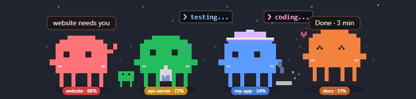
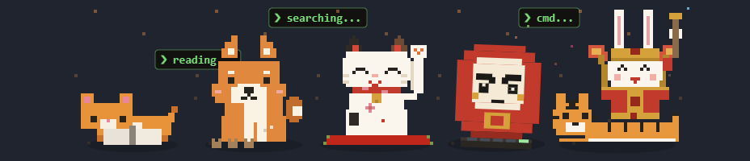
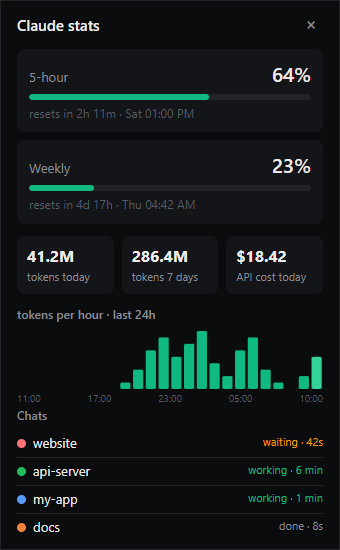

# KungWatch

**One desktop pet per Claude Code chat.** Every chat you open gets its own little character on your taskbar, in its own color, acting out what that chat is doing right now. Click a pet to jump straight to that chat's terminal tab.

[ภาษาไทย](README.th.md)



## What it does

- **One pet per chat, never the same color.** 12 colors, each labelled with the project folder and its context-window %
- **Acts out the current tool.** Thinking, coding, reading, searching, browsing, running commands, git, tests, installs. A mini-clone appears for every running sub-agent
- **Click a pet to focus its chat.** Brings Windows Terminal forward *and selects the right tab*
- **Tells you when to look:**
  - a chat finished (if it worked for at least 30 s)
  - a chat needs permission
  - context hits 80% (`/compact` time)
  - a chat has gone quiet for 5+ minutes (maybe stuck)
  - 5-hour or weekly quota hits 80%

  Each alert is a speech bubble, a Windows notification and a short sound
- **Real quota numbers without logging in.** Reads the `rate_limits` Claude Code already hands to your status line, so no OAuth
- **Stats panel.** 5-hour and weekly quota with reset times, tokens today and over 7 days, API-equivalent cost, an hourly chart and the list of chats
- **Plays with you.** Drag it, throw it, it bounces off the floor and walks across monitors. Its eyes follow the cursor; it likes head pats and giggles when tickled
- **Stays out of the way.** Pets stay on top of full-screen games and videos; sounds go silent there. Turn on **Hide when full-screen** in the right-click menu to hide them instead. `Ctrl+Alt+K` hides or shows every pet. **Do not disturb** mutes notifications and sounds for an hour, until 8 AM, or every night from 22:00 to 08:00. A chat whose terminal window was closed loses its pet within 10 seconds
- **Remembers your picks.** Pick a color per project folder and it sticks. Choose from 6 characters and 4 sizes, with Thai or English UI

 

## Requirements

- Windows 10/11
- [Node.js](https://nodejs.org) 18+
- Claude Code
- Click-to-tab works with Windows Terminal. Other terminals just get their window focused

## Install

```bash
git clone https://github.com/chenlab789/kung-watch.git
cd kung-watch
node install.js
```

`install.js` does the following:
- runs `npm install` (Electron, ~100 MB)
- backs up `~/.claude/settings.json`, then adds 8 hooks
- sets up the status-line bridge. If you already have a status line, it is wrapped and its output stays exactly the same
- puts a shortcut on your desktop

Then start it with `start.vbs` (or the shortcut) and restart Claude Code. Right-click a pet → **Start at login** to launch it automatically.

To remove it: `node uninstall.js` removes the hooks, unwraps the status line, and deletes the shortcut and the startup entry.

## How it works

```
Claude Code ──hooks──▶ hook.js ──┐
            ──status line──▶ statusline-bridge.js ──┴─▶ POST 127.0.0.1:7788 ─▶ KungWatch (Electron)
                                                                        one transparent window per chat
```

- Everything stays on your machine: no network calls, no accounts, no telemetry
- If the app isn't running, the hooks exit silently and don't slow Claude Code down
- KungWatch listens on port 7788. If another program already uses it, KungWatch tells you and exits
- Token counts come from Claude Code's local logs (`~/.claude/projects/**/*.jsonl`)

## Right-click menu

Stats panel · Recent activity · Poke · Hide all · Do not disturb · Color · Character · Size · Notifications · Sound · Cheeky lines · Start at login · Quit

## Credits

The characters and their animations come from **[tokibean](https://github.com/ZGhey/tokibean)** by ZGhey (MIT); see `app/vendor/LICENSE-tokibean`. KungWatch adds the multi-chat engine, click-to-tab, the quota and context alerts, the stats panel and the physics on top.

KungWatch is a community project. It is not affiliated with or endorsed by Anthropic.

## License

MIT. See [LICENSE](LICENSE).
